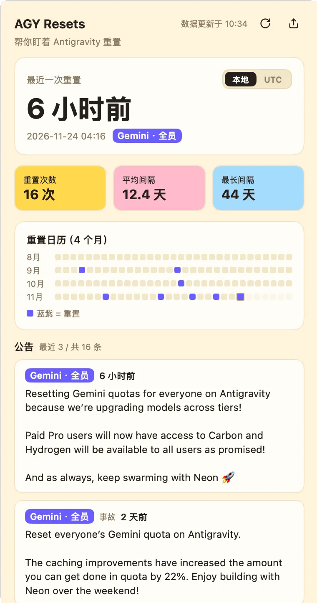

# AGY Resets Bar

Never miss an Antigravity quota reset again.

A menu bar dashboard for [Metrix.Bar](https://metrix.bar) that watches Google Antigravity (Gemini/Argon) reset announcements from [agyresets.com](https://agyresets.com) and tells you when one lands. Data comes from the public agyresets.com API (watching @_mohansolo); this project is not affiliated with Google or Antigravity. [中文说明](README.zh-CN.md)

## Install

Open the link, then open the downloaded file — Metrix.Bar imports `.bar` files directly.

- [`agy-resets.bar`](https://cdn.jsdelivr.net/gh/0tt0/agyresets-bar@v0.2.1/agy-resets.bar)

Or paste this into your browser's address bar to import straight from the CDN:

```text
metrixbar://install?url=https%3A%2F%2Fcdn.jsdelivr.net%2Fgh%2F0tt0%2Fagyresets-bar%40v0.2.1%2Fagy-resets.bar&sha256=b6d171b3dc1499489f660a9d3da0dddf18dacde29d15add40a12ed8f3f232c7c
```

GitHub strips custom schemes from rendered Markdown, so that link is copyable text rather than a clickable anchor.

The dashboard language follows your Metrix.Bar display language — Chinese for `zh*` locales, English otherwise. The language is captured when the dashboard's Worker is created, so reload the dashboard after switching your system or host language.

## What you get

- **How long since the last reset**, in local time or UTC.
- **Scope badges** — which models (Gemini, Argon, all) and plans (everyone, paid) each reset covers.
- **A four-month calendar** — the rhythm, not just the latest entry.
- **Stats**: total resets, average interval, longest gap — matching the agyresets.com homepage.
- **A notification when a new announcement drops**, and never a stale one on install.
- **One-click screenshot sharing.**



## Good to know

It refreshes every 2 minutes; a failed request keeps the last good data and offers Retry. Requests go straight to `agyresets.com`, so that host must be reachable. Alerts are on by default and can be turned off in dashboard settings.

## Development

The `.bar` file is a build artifact — the source lives in `src/` and is bundled with esbuild (zero runtime dependencies; the script never loads anything besides the agyresets.com API).

```sh
npm install        # esbuild (dev dependency)
node build.mjs     # bundle src/ into agy-resets.bar
node build.mjs --check   # validate the committed .bar: XML, script syntax, build freshness
```

For smoke testing, a rendering harness (real API fixtures, mocked `$metrix`/`fetch`, both languages, error/retry, refresh dedup, timezone persistence, notification arming) lives outside the repo in `/tmp` and is run against the built `.bar`'s CDATA script.

## Credits & license

Data comes from the public [agyresets.com](https://agyresets.com) API (watching @_mohansolo). Not affiliated with agyresets.com, Google, or Antigravity.

[Apache-2.0](LICENSE). "Google", "Antigravity", "Gemini" and "Argon" are trademarks of Google, used only to identify the monitored service.
