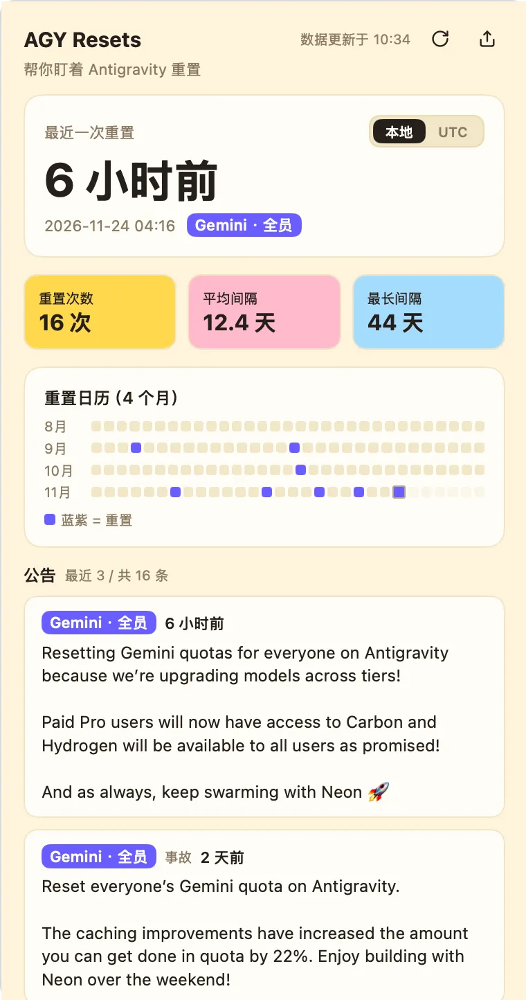

# AGY Resets Bar

Antigravity 额度什么时候重置，你不用再盯着官网刷新。

一个常驻菜单栏的 [Metrix.Bar](https://metrix.bar) 看板，盯着 Google Antigravity（Gemini/Argon）的重置公告，一有动静就告诉你。数据来自 [agyresets.com](https://agyresets.com) 的公开 API（监听 @_mohansolo），与 Google/Antigravity 无隶属关系。[English](README.md)

## 安装

点开下面的链接，再打开下载好的文件即可 —— Metrix.Bar 直接导入 `.bar`。

- [`agy-resets.bar`](https://cdn.jsdelivr.net/gh/0tt0/agyresets-bar@v0.3.0/agy-resets.bar)

也可以把下面这行粘到浏览器地址栏，直接从 CDN 导入：

```text
metrixbar://install?url=https%3A%2F%2Fcdn.jsdelivr.net%2Fgh%2F0tt0%2Fagyresets-bar%40v0.3.0%2Fagy-resets.bar&sha256=f59425f6ecbe4128256dd7e02e97834ace59e2a45d519098e88a447b39a474dc
```

GitHub 渲染 Markdown 时会剥离自定义协议，所以这里以可复制文本给出。

看板语言跟随 Metrix.Bar 宿主显示语言——`zh*` 显示中文，其余显示英文。语言在 Worker 创建（安装或重载看板）时捕获，切换系统或宿主语言后需重载看板才生效。

## 它能帮你做什么

- **一眼知道上次重置过去多久**，可切本地时间或 UTC。
- **分清每次重置的范围**，徽章标明影响的模型（Gemini / Argon / 全部）与人群（全员 / 付费）。
- **近四个月日历**，看到节奏而不只是最新一次。
- **与官网首页对齐的统计**：重置次数、平均间隔、最长间隔。
- **新公告才发通知**，刚装完不会蹦出过期的；点击通知直达公告原文。
- **断网或重启后显示缓存的上次数据**，并标注上次失败。
- **点一下把面板截图复制到剪贴板**。



## 补充说明

每 2 分钟刷新一次；请求失败会保留上一次的数据并给出重试，不会变成空面板。请求直连 `agyresets.com`，本机需要能访问该域名。提醒默认开启，可在看板设置里关闭。

## 开发

`.bar` 文件是构建产物——源码在 `src/`，用 esbuild 打包（零运行时依赖；脚本除 agyresets.com API 外不加载任何东西）。

```sh
npm install        # 安装 esbuild（开发依赖）
node build.mjs     # 打包 src/ 生成 agy-resets.bar
node build.mjs --check   # 校验仓库内 .bar：XML 良构、脚本语法、构建新鲜度
```

冒烟测试（真实 API fixture、mock 的 `$metrix`/`fetch`、双语渲染、失败重试、刷新去重、时区持久化、通知武装）放在仓库外的 `/tmp`，对构建产物 CDATA 脚本运行。

## 来源与许可

数据来自 [agyresets.com](https://agyresets.com) 的公开 API（监听 @_mohansolo 的推文整理），与本项目无隶属关系，也不代表 Google。

[Apache-2.0](LICENSE)。「Google」「Antigravity」「Gemini」「Argon」为 Google 商标，仅用于标识所监控的服务。
